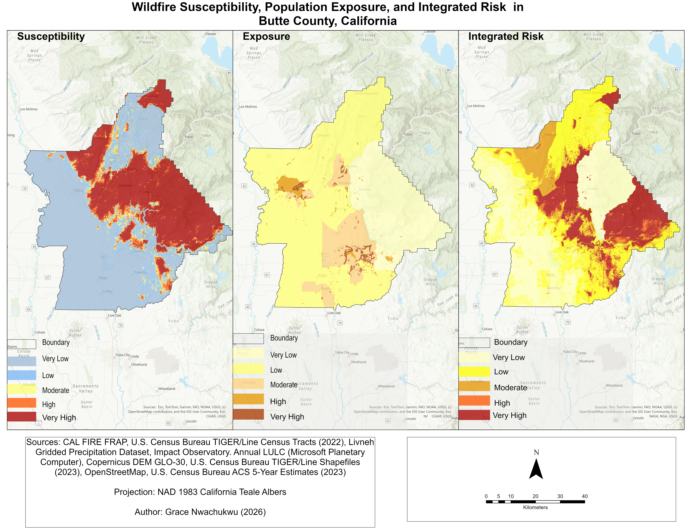
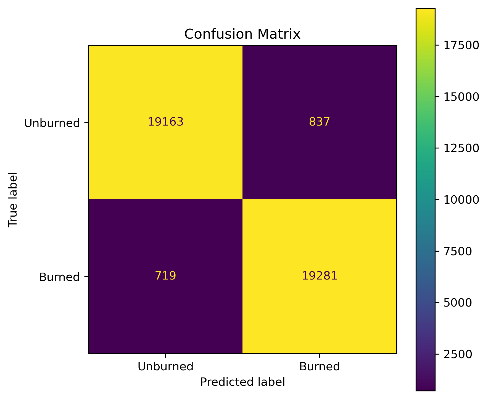
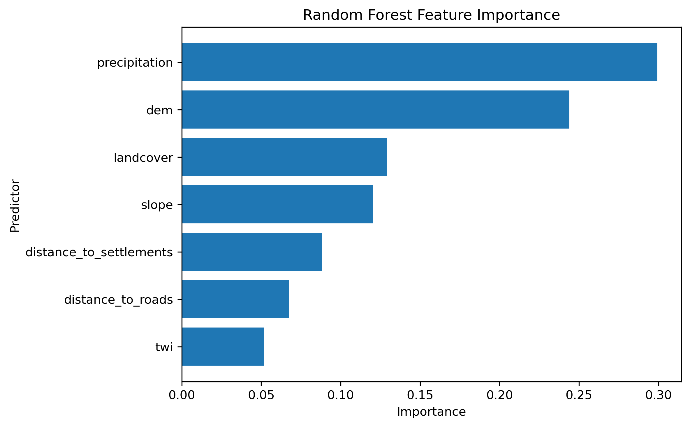
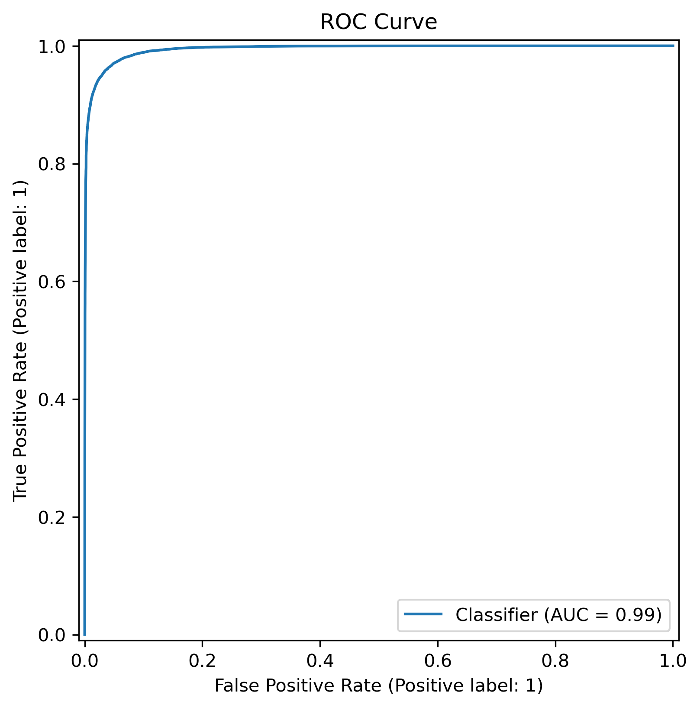

# Supporting Community Wildfire Preparedness in Butte County, California: An Integrated Geospatial Risk Assessment Framework
A reproducible GeoAI framework integrating Random Forest wildfire susceptibility modeling, population exposure, and socioeconomic vulnerability to assess wildfire risk in Butte County, California.

---

## Project Overview

Wildfires pose significant threats to communities through direct exposure to fire, smoke-related health impacts, infrastructure damage, displacement, and disruption of essential services. These impacts are not distributed equally, as communities differ in their exposure to wildfire hazards and their socioeconomic capacity to prepare for, respond to, and recover from wildfire events.

This project develops an integrated geospatial artificial intelligence (GeoAI) framework to assess wildfire risk in Butte County, California. The framework combines Random Forest machine learning for wildfire susceptibility modeling with population exposure and socioeconomic vulnerability assessments to identify areas where environmental hazards and community vulnerability intersect.

Using publicly available geospatial, environmental, demographic, and socioeconomic datasets, the project integrates multiple dimensions of wildfire risk into a spatial assessment framework. The resulting maps provide insights into the geographic distribution of wildfire susceptibility, population exposure, and composite wildfire risk.

The project aims to demonstrate how geospatial analysis and machine learning can support evidence-based wildfire preparedness, community resilience planning, and public health decision-making, particularly in communities facing elevated environmental and socioeconomic risks.

---

## Project Significance

Understanding where wildfire hazards intersect with population exposure and socioeconomic vulnerability is important for effective climate adaptation, community resilience, and public health preparedness.

By integrating machine learning, geospatial analytics, exposure assessment, and community vulnerability indicators, this project provides a reproducible framework for identifying areas of elevated wildfire risk.

The resulting workflow can support:

* Climate adaptation planning
* Community resilience initiatives
* Environmental justice assessments
* Hazard mitigation planning
* Public health preparedness
* Resource prioritization and decision support

---

## Project Objectives

The overall objective is to develop a reproducible geospatial risk assessment framework integrating wildfire susceptibility, population exposure, and socioeconomic vulnerability in Butte County, California.

The specific objectives are to:

1. **Develop a wildfire susceptibility model:** Apply Random Forest machine learning to environmental and anthropogenic predictors to generate a spatial representation of wildfire susceptibility.

2. **Assess population exposure:** Examine population density and Wildland–Urban Interface (WUI) distribution in relation to wildfire susceptibility to identify potentially exposed communities.

3. **Evaluate socioeconomic vulnerability:** Incorporate poverty, older adult population, income characteristics, and disability indicators to characterize spatial differences in community vulnerability.

4. **Integrate wildfire risk dimensions:** Combine wildfire susceptibility, population exposure, and socioeconomic vulnerability into a composite wildfire risk assessment framework.

5. **Generate decision-support maps:** Produce spatial outputs illustrating wildfire susceptibility, population exposure, and integrated wildfire risk across Butte County.

6. **Support public health and community preparedness:** Demonstrate how integrated geospatial analysis can inform targeted wildfire preparedness, climate resilience planning, and public health decision-making.


---

## Study Area

Butte County is located in Northern California, USA, spanning portions of the northern Sacramento Valley and the Sierra Nevada foothills. The county has diverse environmental and geographical conditions, including varied terrain, vegetation, and land-use patterns.

Butte County was selected as the study area because of its history of destructive wildfire events, extensive Wildland–Urban Interface (WUI) development, diverse environmental conditions, and importance for climate resilience planning.


---

## Data and Methodology

This project uses publicly available geospatial, environmental, demographic, and socioeconomic datasets to develop an integrated wildfire risk assessment framework.

The following workflow summarizes the geospatial processing and analytical stages used to develop the integrated wildfire risk assessment framework.


### 1. Data Sources and Acquisition

The primary datasets and their applications include:

| Dataset | Source | Application |
|---|---|---|
| Historical wildfire perimeters | CAL FIRE | Wildfire occurrence information and model training |
| Digital Elevation Model (DEM) | USGS | Terrain analysis and predictor development |
| Land cover | National Land Cover Database (NLCD) | Environmental predictor |
| Precipitation | Microsoft Planetary Computer | Environmental predictor |
| Roads and settlements | OpenStreetMap | Human influence and distance-based predictors |
| Population data | U.S. Census Bureau | Population exposure assessment |
| Socioeconomic indicators | American Community Survey (ACS) | Community vulnerability assessment |
| County boundary | California State Geoportal | Study area definition and spatial clipping |

The automated data acquisition workflow includes:

- Dataset querying and retrieval
- Downloading publicly available datasets
- Spatial clipping to the study area
- Reprojection and data organization

### 2. Spatial Data Preprocessing

Raster and vector datasets were standardized to support consistent spatial analysis.

The preprocessing workflow included:

- Coordinate system reprojection
- Spatial clipping to the Butte County boundary
- Raster alignment
- Resampling to a common spatial resolution
- NoData handling
- Raster masking
- Data normalization

These procedures prepared the datasets for subsequent spatial analysis, predictor development, and modeling.

### 3. Predictor Preparation and Feature Engineering

Environmental and anthropogenic predictors were developed for wildfire susceptibility modeling.

**Environmental predictors:**

- Elevation
- Slope
- Topographic Wetness Index (TWI)
- Precipitation
- Land cover

**Anthropogenic predictors:**

- Distance to roads
- Distance to settlements

Terrain derivatives, including slope and TWI, were generated from elevation data. Distance-based variables were developed to represent the influence of human infrastructure and settlement patterns.

### 4. Wildfire Susceptibility Modeling

A Random Forest machine learning algorithm was used to model wildfire susceptibility based on the prepared environmental and anthropogenic predictors.

Historical wildfire perimeter information was used in preparing the model training data and wildfire occurrence labels.

The model was trained to identify spatial patterns associated with wildfire occurrence and generate a continuous wildfire susceptibility surface across Butte County.

### 5. Population Exposure Assessment

Population exposure was assessed by integrating population density and Wildland–Urban Interface (WUI) information.

The analysis examined the spatial distribution of populations in relation to wildfire-prone areas to identify communities potentially exposed to wildfire hazards.

The resulting exposure layer represents the spatial distribution of population exposure across the study area.

### 6. Socioeconomic Vulnerability Assessment

Community vulnerability was assessed using demographic and socioeconomic indicators obtained from the American Community Survey (ACS).

The indicators included:

- Poverty
- Older adult population
- Income characteristics
- Disability indicators

These indicators were processed and combined to develop a spatial vulnerability index representing differences in community socioeconomic conditions and potential capacity to prepare for, respond to, and recover from wildfire impacts.

### 7. Integrated Wildfire Risk Assessment

Wildfire susceptibility, population exposure, and socioeconomic vulnerability were integrated to produce a composite wildfire risk surface.

The conceptual framework represents wildfire risk as:

**Risk = Susceptibility × Exposure × Vulnerability**

The integrated assessment identifies geographic areas where elevated wildfire susceptibility intersects with population exposure and socioeconomic vulnerability.

The final output is a spatially explicit wildfire risk map for Butte County, California, intended to support community preparedness, climate resilience planning, and public health decision-making.

---

## Results

The integrated GeoAI framework generated spatial outputs describing wildfire susceptibility, population exposure, and composite wildfire risk across Butte County, California. The results reveal distinct spatial patterns shaped by environmental conditions, population distribution, and socioeconomic vulnerability.



### 1. Wildfire Susceptibility Assessment

The Random Forest model generated a continuous wildfire susceptibility surface showing spatial variations in wildfire-prone conditions across Butte County.

Areas classified as **high and very high susceptibility** were concentrated primarily in the eastern, southeastern, and central foothill and mountainous regions of the county. Elevated susceptibility was particularly evident around **Paradise, Magalia, and portions of the Sierra Nevada foothills**. In contrast, the western agricultural valley regions surrounding **Chico and Oroville** were predominantly characterized by low-susceptibility classes.

These spatial patterns highlight the influence of environmental and topographic conditions on the geographic distribution of wildfire susceptibility across the study area.

### 2. Population Exposure Assessment

The population exposure assessment revealed spatial differences in the distribution of populations potentially exposed to wildfire hazards.

Higher exposure levels were concentrated around developed areas and Wildland–Urban Interface (WUI) environments, particularly surrounding **Chico, Paradise, Magalia, and Oroville**.

In contrast, extensive forested areas in the northern and eastern portions of the county exhibited relatively lower population exposure despite elevated wildfire susceptibility. This distinction demonstrates that areas with high wildfire susceptibility do not necessarily correspond to areas with high population exposure.

The results emphasize the importance of considering population distribution alongside wildfire susceptibility when evaluating potential community exposure.

### 3. Integrated Wildfire Risk Assessment

The integrated wildfire risk assessment combined wildfire susceptibility, population exposure, and socioeconomic vulnerability to identify geographic areas where these dimensions intersect.

**High and very high wildfire risk zones** were concentrated primarily across the central and eastern portions of Butte County, particularly around **Paradise, Magalia, and adjacent foothill communities**. Additional areas of elevated risk were identified near **Oroville** and other portions of the WUI.

In contrast, some mountainous areas with elevated wildfire susceptibility exhibited lower integrated risk because of comparatively lower population exposure. The western agricultural valley regions also generally exhibited lower composite risk.

These patterns demonstrate the spatial heterogeneity of wildfire risk and highlight the importance of integrating environmental hazard conditions with population exposure and socioeconomic vulnerability.

The resulting composite risk map provides a spatial basis for identifying communities that may warrant greater attention in wildfire preparedness, mitigation, and resilience planning.

### Overall Results

Overall, the findings demonstrate that wildfire susceptibility, population exposure, and socioeconomic vulnerability exhibit distinct but intersecting spatial patterns across Butte County. Their integration provides a more comprehensive representation of community wildfire risk than consideration of wildfire susceptibility alone.

---

## Model Evaluation

The Random Forest wildfire susceptibility model was evaluated using classification performance metrics, a confusion matrix, and five-fold cross-validation. Feature importance analysis and ROC curve assessment were also used to examine model discrimination performance and the relative contribution of environmental and anthropogenic predictors.

### 1. Classification Performance

The model demonstrated strong classification performance on the evaluation dataset, achieving an accuracy of **96.11%** and an F1-score of **96.12%**.

| Evaluation Metric | Score |
|---|---:|
| Accuracy | 96.11% |
| Precision | 95.84% |
| Recall | 96.41% |
| F1-score | 96.12% |
| ROC-AUC | 0.9943 |

The ROC-AUC score of 0.9943 indicates strong discrimination between the wildfire occurrence classes in the reported test-set evaluation.

### 2. Confusion Matrix

The confusion matrix illustrates the agreement between observed and predicted wildfire occurrence classes.



The model correctly classified 19,163 non-wildfire observations and 19,281 wildfire observations. It recorded 837 false positives and 719 false negatives, demonstrating strong classification performance across both classes.

### 3. Five-Fold Cross-Validation

Five-fold cross-validation was performed to examine the consistency of model discrimination performance across five validation folds.

The ROC-AUC scores obtained from the individual folds are presented below.

| Validation Fold | ROC-AUC |
|---|---:|
| Fold 1 | 0.9885 |
| Fold 2 | 0.9876 |
| Fold 3 | 0.9888 |
| Fold 4 | 0.9888 |
| Fold 5 | 0.9872 |
| **Mean ROC-AUC** | **0.9881** |
| **Standard Deviation** | **0.00066** |

The mean five-fold ROC-AUC of 0.9881, accompanied by a standard deviation of 0.00066, indicates relatively consistent discrimination performance across the five validation folds.

### 4. Random Forest Feature Importance

Feature importance analysis was conducted to examine the relative contribution of environmental and anthropogenic predictors to the Random Forest wildfire susceptibility model.



The results identified **precipitation and elevation** as the leading predictors, followed by land cover and slope. Distance to roads, distance to settlements, and topographic wetness index (TWI) also contributed to the model.

Feature importance represents the relative contribution of predictors within the fitted model and should not be interpreted as evidence of direct causation.

### 5. Receiver Operating Characteristic (ROC) Curve

The Receiver Operating Characteristic (ROC) curve illustrates the model's ability to distinguish between wildfire occurrence and non-wildfire classes across different classification thresholds.



The test-set ROC-AUC of 0.9943 indicates strong discrimination between the two classes in the reported evaluation.

### Model Evaluation Summary

Overall, the Random Forest model demonstrated strong classification performance, achieving a test-set ROC-AUC of 0.9943 and a mean five-fold cross-validation ROC-AUC of 0.9881.

The classification metrics, confusion matrix, and cross-validation results provide complementary evidence of model performance. Feature importance analysis further identifies the predictors that contributed most to the model's wildfire susceptibility classifications.

These evaluation results support the use of the Random Forest model to generate the wildfire susceptibility surface used in the subsequent population exposure and integrated wildfire risk assessments.

---

## Discussion

The findings of this study demonstrate the spatial heterogeneity of wildfire susceptibility, population exposure, and integrated wildfire risk across Butte County, California. The concentration of elevated wildfire susceptibility across the eastern, southeastern, and central foothill and mountainous regions highlights the influence of environmental and topographic conditions on wildfire-prone landscapes. The prominence of precipitation and elevation among the Random Forest predictors is consistent with previous research demonstrating the influence of climatic conditions on wildfire activity across western United States forests (Abatzoglou & Williams, 2016). These findings highlight the importance of environmental and terrain-related characteristics in understanding the spatial distribution of wildfire susceptibility. However, the relative importance of these predictors within the fitted model should not be interpreted as evidence of direct causation or climate attribution.

The population exposure assessment revealed that areas with elevated wildfire susceptibility do not necessarily correspond to locations with the highest population exposure. This distinction reinforces the importance of considering human settlement patterns alongside environmental wildfire conditions. The observed spatial distribution aligns with previous research demonstrating that expansion of the Wildland–Urban Interface (WUI) has substantially increased the number of people, homes, and other assets located within wildfire-prone landscapes across the United States (Radeloff et al., 2018). Studies conducted in California further demonstrate the significance of settlement patterns within fire-prone landscapes. Kramer et al. (2019) found that interface WUI areas accounted for approximately half of the buildings destroyed in the California wildfires examined. Similarly, Syphard and Keeley (2019) investigated factors associated with structural loss during the 2013–2018 California wildfires, identifying building characteristics and homeowner mitigation practices as important considerations for structure survival. The concentration of elevated population exposure around Paradise, Magalia, Chico, and Oroville in this study reflects the growing interaction between human settlements and wildfire-prone environments, a pattern documented across western North America.

The integrated wildfire risk assessment extends the susceptibility and exposure analyses by incorporating socioeconomic vulnerability. These findings reinforce the principle that disaster risk is not determined solely by hazard occurrence but by the interaction of hazard, exposure, and vulnerability (IPCC, 2022; UNDRR, 2017). Previous research by Chas-Amil et al. (2022) demonstrated the importance of considering social vulnerability alongside wildfire risk and WUI distribution when developing geographically targeted preparedness, mitigation, and adaptation strategies. Their research in Galicia, Spain, identified spatial relationships between social vulnerability and wildfire risk, highlighting the importance of incorporating socioeconomic characteristics into wildfire risk assessment. In the present study, the inclusion of poverty, older adult population, income characteristics, and disability indicators provides a spatial representation of selected socioeconomic dimensions that may influence community preparedness and resilience. The results are consistent with previous research showing that socially vulnerable populations may experience disproportionate wildfire impacts because of differences in adaptive capacity and access to resources (Chas-Amil et al., 2022).

The concentration of elevated integrated wildfire risk around Paradise, Magalia, and surrounding foothill communities is particularly noteworthy given Butte County's history of destructive wildfire events. The 2018 Camp Fire demonstrated the severe consequences that can occur when wildfire hazards intersect with exposed populations and developed communities. The fire spread through communities including Concow, Paradise, and Magalia, resulting in extensive structural destruction, widespread evacuations, and loss of life (NIST, 2020). This historical event provides important local context for interpreting the spatial patterns identified in the present assessment. Although this study does not retrospectively validate the Camp Fire or predict future fire events, its findings highlight the importance of identifying areas where wildfire susceptibility, population exposure, and socioeconomic vulnerability intersect.

From a public health perspective, the findings highlight the importance of integrating environmental risk assessment with community preparedness and resilience planning. Wildfires have public health consequences extending beyond direct fire exposure, particularly through smoke-related air pollution and associated respiratory and cardiovascular health concerns. Rappold et al. (2017) examined community vulnerability to the health impacts of wildland fire smoke exposure, demonstrating the importance of identifying populations that may be more susceptible to smoke-related health impacts. Similarly, Vargo et al. (2023) documented the relationship between wildfire smoke exposure and social disadvantage across communities in the United States. Although the present project does not directly measure wildfire smoke exposure, respiratory illness, or other health outcomes, its integration of population exposure and socioeconomic vulnerability provides a geospatial framework that can inform public health preparedness and community resilience planning.

The findings also have implications for environmental justice and equitable disaster risk reduction. Communities experiencing elevated wildfire susceptibility alongside socioeconomic vulnerability may face additional challenges in preparing for, responding to, and recovering from wildfire events. Identifying these spatial intersections can help inform targeted community outreach, evacuation planning, preparedness initiatives, and the prioritization of resilience resources. The resulting spatial assessment can support climate adaptation, hazard mitigation, and public health planning by providing geographic evidence of where environmental wildfire hazards and selected dimensions of community vulnerability overlap.

Overall, this study demonstrates the value of integrating machine learning-based wildfire susceptibility modeling with population exposure and socioeconomic vulnerability assessment. The findings show that wildfire susceptibility alone provides an incomplete representation of community wildfire risk. Incorporating population distribution and socioeconomic characteristics offers a broader understanding of where environmental hazards and community vulnerability intersect. The developed GeoAI framework provides a reproducible geospatial approach that can support wildfire preparedness, climate resilience, environmental justice assessments, and public health decision-making in Butte County and other wildfire-prone regions.

---

## Reference

Abatzoglou, J. T., & Williams, A. P. (2016). Impact of anthropogenic climate change on wildfire across western US forests. Proceedings of the National Academy of Sciences, 113(42), 11770–11775.

Chas-Amil, M. L., Touza, J., García-Martínez, E., & Varela, E. (2022). Spatial patterns of social vulnerability in relation to wildfire risk. Landscape and Urban Planning, 228, 104566.

IPCC. (2022). Climate Change 2022: Impacts, Adaptation and Vulnerability. Working Group II Contribution to the Sixth Assessment Report of the Intergovernmental Panel on Climate Change.

Jain, P., Coogan, S. C. P., Subramanian, S. G., Crowley, M., Taylor, S., & Flannigan, M. D. (2020). A review of machine learning applications in wildfire science and management. Environmental Reviews, 28(4), 478–505.

Kramer, H. A., Mockrin, M. H., Alexandre, P. M., & Radeloff, V. C. (2019). High wildfire damage in interface communities in California. International Journal of Wildland Fire, 28(9), 641–650.

NIST. (2020). *Camp Fire Preliminary Reconnaissance*. National Institute of Standards and Technology, Technical Note 2105.

Radeloff, V. C., Helmers, D. P., Kramer, H. A., et al. (2018). Rapid growth of the US wildland–urban interface raises wildfire risk. Proceedings of the National Academy of Sciences, 115(13), 3314–3319.

Syphard, A. D., Keeley, J. E., & Massada, A. B. (2019). Housing arrangement and location determine the likelihood of housing loss due to wildfire. PLoS ONE, 7(3), e33954.

United Nations Office for Disaster Risk Reduction (UNDRR). 2017. The Sendai Framework Terminology on Disaster Risk Reduction. "Disaster risk". Accessed 1 November 2026.  https://www.undrr.org/terminology/disaster-risk.

---


## Census API Configuration

This research uses the U.S. Census Bureau API to retrieve American Community Survey (ACS) demographic and socioeconomic data for the population exposure and community vulnerability assessments.

### Obtain a Census API Key

Request a free Census API key:

* [Census API Key Signup](https://api.census.gov/data/key_signup.html)

### Configure the API Key

The current implementation reads the Census API key from two locations:

- `config/config.yaml`: Used by the socioeconomic vulnerability data downloader.
- `src/download/population.py`: Contains a separate `CENSUS_API_KEY` configuration variable for the population data downloader.

Replace the placeholder values with a valid API key in your local working copy before executing the corresponding scripts.

**Security note:** Do not commit personal API keys to the public GitHub repository. Retain the placeholder values in the publicly shared files.

### Download Census Data

Population data:

```bash
python src/download/population.py
```

Vulnerability data:

```bash
python src/download/vulnerability.py
```

### Documentation

* [Census Developers Documentation](https://www.census.gov/data/developers/data-sets.html)


### Census API Documentation

https://www.census.gov/data/developers/data-sets.html

---

## Workflow Execution

The project was designed as a reproducible command-line geospatial workflow. Core data acquisition, preprocessing, feature engineering, machine learning, exposure assessment, vulnerability assessment, and risk modeling steps are executed through Python scripts rather than Jupyter notebooks.

This approach improves reproducibility, automation, scalability, and transparency while reducing manual processing steps.

### 1. Data Acquisition

Download all required datasets:

```bash
python src/download/download_boundary.py
python src/download/download_dem.py
python src/download/landcover.py
python src/download/population.py
python src/download/precipitation.py
python src/download/roads.py
python src/download/vulnerability.py
python src/download/wildfire.py
```

### 2. Data Preprocessing

Standardize coordinate systems, spatial extent, raster alignment, and resolution:

```bash
python src/preprocessing/reproject.py
python src/preprocessing/clip.py
python src/preprocessing/align.py
python src/preprocessing/standardize.py
```

### 3. Feature Engineering

Generate terrain and distance-based predictors used by the machine learning model:

```bash
python src/features/distance.py
python src/features/terrain.py
```

### 4. Wildfire Susceptibility Modeling

Prepare training data, train the Random Forest model, evaluate model performance, and generate the wildfire susceptibility surface:

```bash
python src/modeling/training_data.py
python src/modeling/labels.py
python src/modeling/random_forest.py
python src/modeling/evaluation.py
python src/modeling/feature_importance.py
python src/modeling/susceptibility.py
```

### 5. Exposure Assessment

Generate population density, Wildland–Urban Interface (WUI), and exposure layers:

```bash
python src/exposure/population_raster.py
python src/exposure/wui.py
python src/exposure/exposure.py
```

### 6. Vulnerability Assessment

Generate the community vulnerability index:

```bash
python src/exposure/vulnerability_index.py
```

### 7. Wildfire Risk Assessment

Integrate susceptibility, exposure, and vulnerability layers into a composite wildfire risk surface:

```bash
python src/risk/risk.py
```

### 8. Results Exploration

Three Jupyter notebooks are provided for visualization, interpretation, and quality assurance:

```text
01_model_evaluation.ipynb
02_susceptibility_mapping.ipynb
03_risk_assessment.ipynb
```

The notebooks are intended for analysis and interpretation of model outputs rather than execution of the primary processing workflow.

---


## Technology Stack

### Programming & Workflow

* Python
* Jupyter Notebook
* Linux (WSL Ubuntu)
* Git & GitHub
* Conda

### Geospatial Analysis

* GeoPandas
* Rasterio
* Rioxarray
* WhiteboxTools
* OSMnx

### Machine Learning

* Scikit-learn
* Random Forest

### Visualization

* Matplotlib
* ArcGIS Pro

---

## Repository Structure

```text
.
## Repository Structure

```text
wildfire-geoai-california/
│
├── README.md
├── LICENSE
├── environment.yaml
│
├── config/
│   └── config.yaml
│
├── data/
│   ├── features/
│   ├── raw/                  # Generated locally; excluded from Git
│   ├── interim/              # Generated locally; excluded from Git
│   ├── processed/            # Generated locally; excluded from Git
│   └── training/             # Generated locally; excluded from Git
│
├── notebooks/
│   ├── 01_model_evaluation.ipynb
│   ├── 02_susceptibility_mapping.ipynb
│   └── 03_risk_assessment.ipynb
│
├── outputs/
│   ├── feature_importance/
│   ├── figures/
│   ├── maps/
│   ├── model_evaluation/
│   └── models/               # Model files excluded from Git
│
└── src/
    ├── download/
    ├── preprocessing/
    ├── features/
    ├── modeling/
    ├── exposure/
    └── risk/
```

---


## Reproducibility

This repository provides a modular geospatial machine learning workflow supported by Python scripts, configuration files, and Jupyter notebooks.

Reproducibility is supported through:

- Version control using Git and GitHub.
- Conda-based environment management.
- Automated geospatial data acquisition.
- Modular data preprocessing and feature engineering scripts.
- Documented Random Forest modeling and evaluation procedures.
- Publicly available geospatial and demographic data sources.
- Jupyter notebooks for visualization, interpretation, and quality assurance.

Raw datasets, intermediate processing files, and selected model artifacts are excluded from version control and must be generated locally when reproducing the workflow.

Refer to the Workflow Execution and Installation and Setup sections for implementation instructions.

## Installation and Setup

### System Requirements

The project environment is configured for:

- Python 3.11
- Conda (recommended)
- Linux or Windows Subsystem for Linux (WSL Ubuntu)
- JupyterLab
- ArcGIS Pro (optional, for cartographic map production)

### Clone the Repository

```bash
git clone https://github.com/Gracey0201/wildfire-geoai-california.git

cd wildfire-geoai-california
```

### Create the Conda Environment

```bash
conda env create -f environment.yaml

conda activate wildfire-geoai
```

### Verify Installation

Confirm that required packages are available:

```bash
python -c "import geopandas, rasterio, sklearn; print('Installation successful')"
```

### Reproduce the Analysis

Follow the commands documented in the Workflow Execution section to run the data acquisition, preprocessing, feature engineering, modeling, exposure, vulnerability, and integrated risk assessment stages.

The Jupyter notebooks provide additional visualization, model interpretation, and quality assurance of the resulting outputs.


---

## Limitations and Future Work

### Limitations

Several limitations should be considered when interpreting the findings of this study:

- **Data resolution and temporal coverage:** Differences in spatial resolution and temporal coverage among input datasets may influence the representation of wildfire susceptibility, population exposure, and socioeconomic vulnerability.
- **Model validation:** Potential spatial autocorrelation among geospatial observations may influence model evaluation results. Future spatially independent validation is needed to further assess model generalizability.
- **Socioeconomic indicators:** The vulnerability assessment incorporates selected socioeconomic indicators, including poverty, older adult population, income characteristics, and disability indicators. These variables do not capture all dimensions of community vulnerability or adaptive capacity.
- **Public health outcomes:** The study assesses population exposure and socioeconomic vulnerability but does not directly measure wildfire smoke exposure, air quality, respiratory illness, or other health outcomes.

---


### Future Work

Future research could extend the framework through:

- **Explainable Artificial Intelligence (XAI):** Apply SHAP analysis to improve model interpretability and examine predictor contributions.
- **Climate projection integration:** Incorporate future climate projections to explore potential changes in wildfire susceptibility under different climate scenarios.
- **Environmental justice analysis:** Apply spatial hotspot analysis to identify areas where wildfire risk and socioeconomic disadvantage intersect.
- **Interactive Web GIS deployment:** Develop an interactive platform for communicating spatial risk patterns to researchers, planners, and communities.
- **Multi-county scaling:** Extend the framework to additional wildfire-prone counties across California to examine its transferability.
- **Temporal wildfire forecasting:** Incorporate temporal datasets and modeling approaches to investigate changes in wildfire susceptibility and potential future wildfire patterns.
  

---


## License

This project is licensed under the MIT License.
